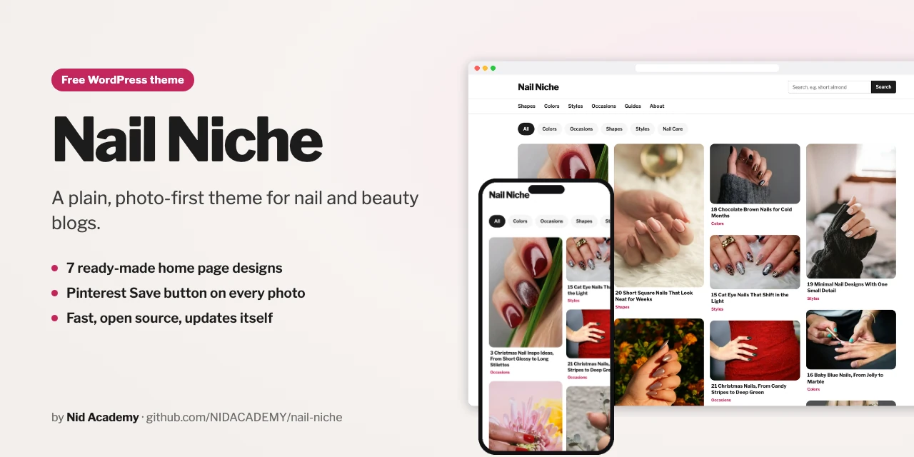
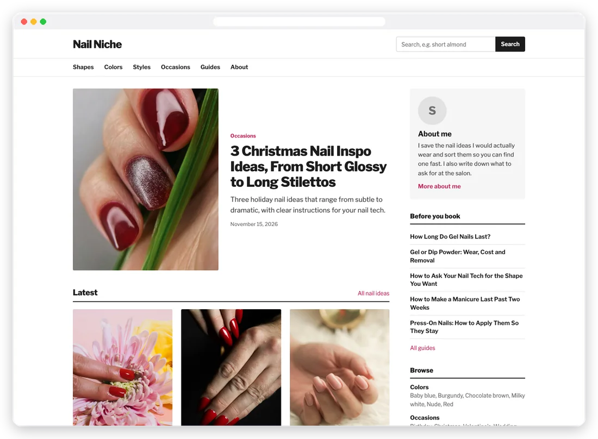
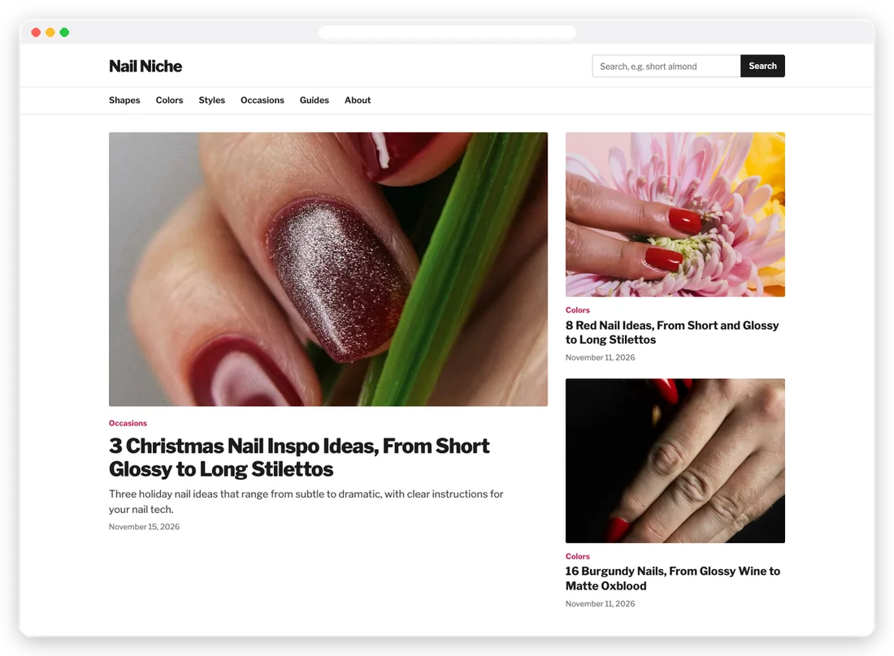
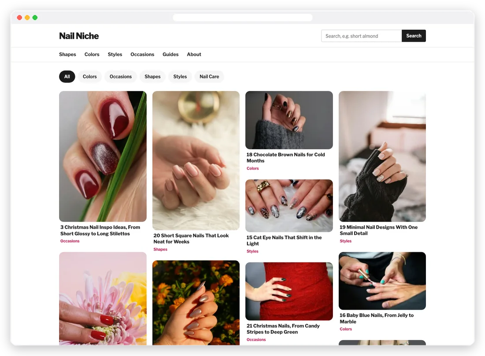
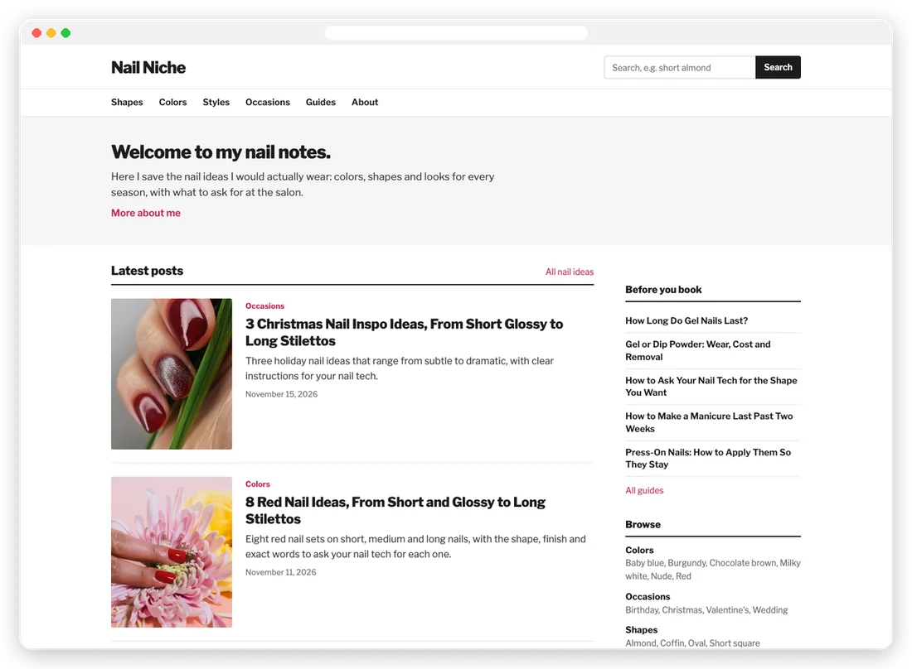
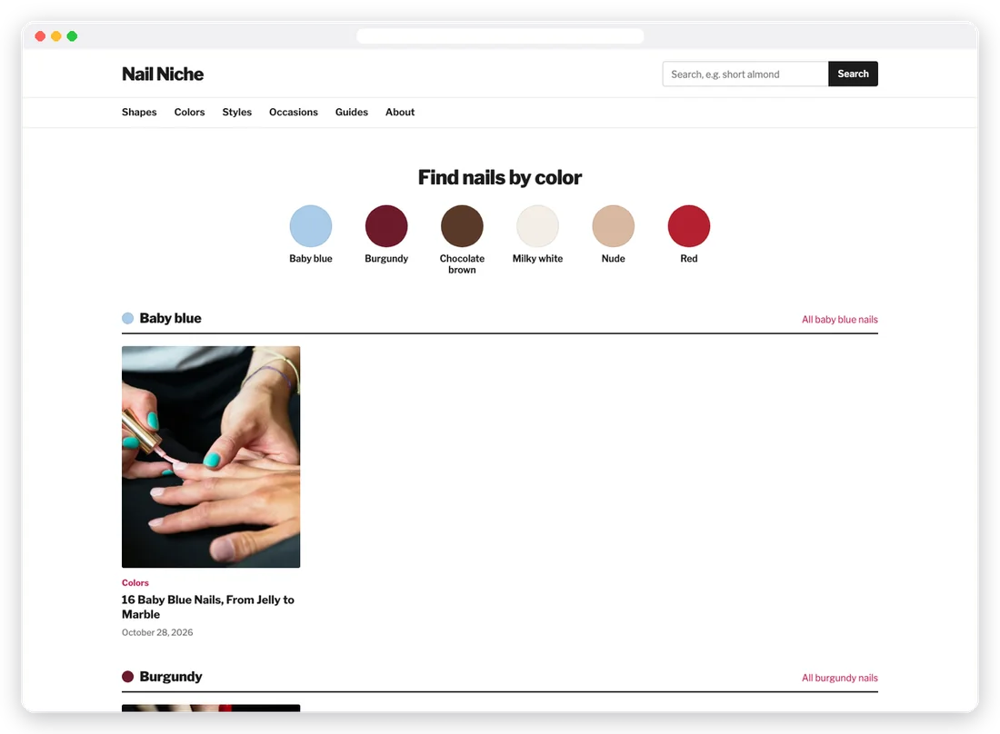
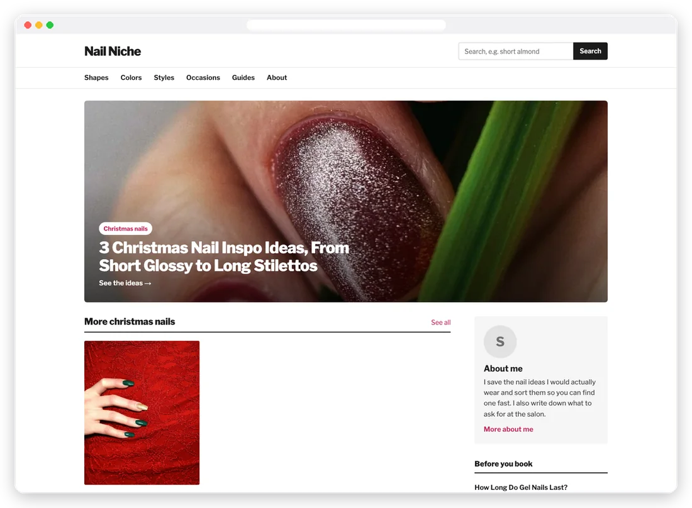
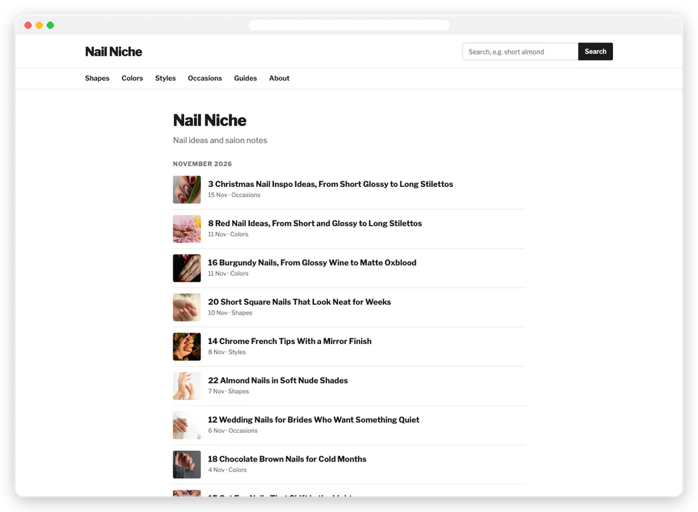
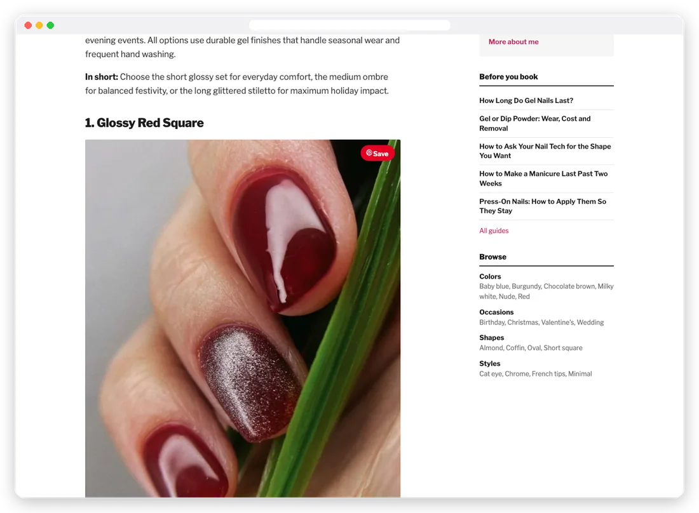
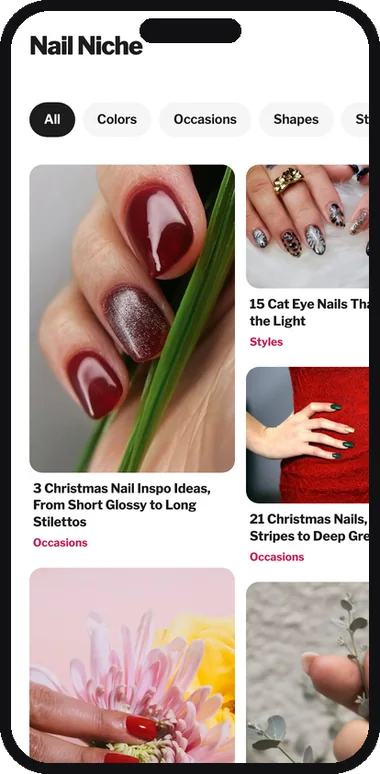

  

  
  
  
  
  

  
  
  

  <a href="#-download">Download</a> ·
  <a href="#-home-designs">Home designs</a> ·
  <a href="#-features">Features</a> ·
  <a href="#-install">Install</a> ·
  <a href="#-updates">Updates</a> ·
  <a href="#-follow-nid-academy">Follow</a>

---

**Nail Niche** is a free WordPress theme made for nail and beauty blogs: big photos, clean pages, and the things a Pinterest-driven blog needs, without a page builder.

## ⬇ Download

**[Download nail-niche.zip](https://github.com/NIDACADEMY/nail-niche/releases/latest/download/nail-niche.zip)** (latest release), then upload it in **Appearance → Themes → Add New → Upload Theme**.

## 🎨 Home designs

Pick one in **Appearance → Customize → Home design**. The preview changes as soon as you click.

<table>
  <tr>
    <td width="50%"> <b>Classic</b>: lead post, latest posts and a row per category, with the sidebar.</td>
    <td width="50%"> <b>Magazine</b>: one big featured post and two smaller ones, full width.</td>
  </tr>
  <tr>
    <td> <b>Pinterest board</b>: a wall of tall photos with category buttons.</td>
    <td> <b>Personal blog</b>: a welcome from you, then a simple list of posts.</td>
  </tr>
  <tr>
    <td> <b>Color shop</b>: color swatches, then a row of posts for each color.</td>
    <td> <b>Seasonal</b>: a banner for the season or holiday, picked by date.</td>
  </tr>
  <tr>
    <td> <b>Minimal list</b>: a short intro and post titles by month.</td>
    <td> <b>Posts</b>: large photos, each with a Pinterest <b>Save</b> button.</td>
  </tr>
</table>

 Made for phones first: menus, photo walls and category buttons all fit a small screen.

## ✨ Features

| | |
|---|---|
| 📌 **Pinterest Save button** | On every photo in a post. It saves that exact photo, full size, with the post's link and the photo's description. |
| 🏠 **Seven home designs** | Classic, Magazine, Pinterest board, Personal blog, Color shop, Seasonal and Minimal list. |
| 🎨 **Your look** | Logo, accent colour, About box (photo, heading, text) and welcome text, all in the Customizer. |
| 🗂 **Smart categories** | A guides category with its own sidebar list, and a colors category that powers the Color shop swatches. |
| 💬 **Comments** | Clean comments with replies under posts. |
| 🧩 **Widget areas** | One for the home page sidebar, one for posts and archives: add Custom HTML, images, latest posts… |
| 💸 **Affiliate-ready** | Affiliate links get `rel="sponsored nofollow"` automatically, plus a short disclosure on the post. |
| 🔍 **Search-friendly** | One main heading per page, share tags until an SEO plugin takes over, and staging copies kept out of Google. |
| ⚡ **Fast** | One stylesheet, one small script, one self-hosted font. No page builder, no jQuery. |
| 🔄 **Updates itself** | New releases show under Dashboard → Updates. |

## 🚀 Install

1. [Download `nail-niche.zip`](https://github.com/NIDACADEMY/nail-niche/releases/latest/download/nail-niche.zip).
2. In WordPress, go to **Appearance → Themes → Add New → Upload Theme**, choose the zip, then **Install Now** and **Activate**.
3. Go to **Appearance → Customize**:
   - **Site Identity**: your logo.
   - **Home design**: pick a home page.
   - **Theme options**: accent colour and categories.
   - **About box**: your photo and a few words about you.
4. Add your menus in **Appearance → Menus** (Main menu and Footer menu).

**Requirements:** WordPress 6.4+ and PHP 7.4+.

## 🔄 Updates

Once installed, new versions appear under **Dashboard → Updates** like any other theme. You can also turn on auto-updates in **Appearance → Themes**. See the [changelog](CHANGELOG.md).

## 🤝 Works well with

- **[Pin Poster](https://github.com/NIDACADEMY/pin-poster)**: our free plugin that writes nail-idea posts with AI and sends their photos to Pinterest through Buffer.
- An SEO plugin such as **Rank Math** (the theme's basic share tags switch off when one is active).
- An ad plugin such as **Ad Inserter**.

**Customising one site?** Use a small child theme, so updates never overwrite your changes.

## 📣 Follow Nid Academy

Tutorials, tips and new releases:

  
  
  

Found a bug or have an idea? [Open an issue](https://github.com/NIDACADEMY/nail-niche/issues).

## 📄 License

GPL-2.0-or-later. See [LICENSE](LICENSE). Bundled font: Libre Franklin (SIL Open Font License 1.1).

Made with care by <a href="https://www.nidacademy.org/">Nid Academy</a>

