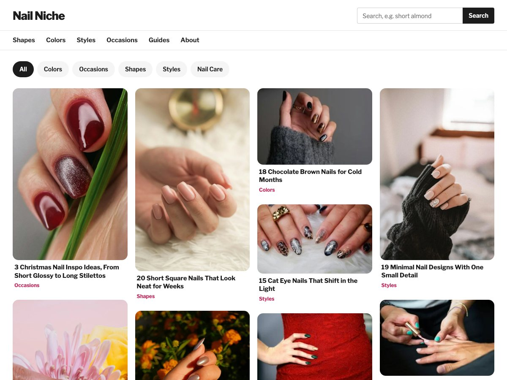

# Nail Niche

A free, plain, photo-first WordPress theme for nail and beauty blogs.

## Features

- **Seven home page designs** (Appearance → Customize → Home design):
  Classic, Magazine, Pinterest board, Personal blog, Color shop, Seasonal and Minimal list.
- **Pinterest Save button** on every photo in a post. It saves that exact photo with the post's link.
- **Comments** under posts, with replies.
- **About box** in the sidebar and under posts (photo, heading, text).
- **Theme options**: accent colour, a guides category with its own sidebar list, and a colors category for the Color shop design.
- **Two sidebar widget areas** (home page, and posts and archives) for any block: Custom HTML, Image, Latest Posts…
- **Affiliate links** are marked `rel="sponsored nofollow"` and a short disclosure is added to the post.
- **Staging copies stay out of Google** (staging addresses, `.local`, `localhost`, or a WordPress environment type of staging/development/local).
- **Fast**: one stylesheet, one small script, one self-hosted font, no page builder.
- **Automatic updates** from this repository's releases.

## Install

1. Download `nail-niche.zip` from the [latest release](https://github.com/NIDACADEMY/nail-niche/releases/latest).
2. In WordPress, go to **Appearance → Themes → Add New → Upload Theme**, choose the zip, then **Install Now** and **Activate**.
3. Go to **Appearance → Customize**:
   - **Site Identity**: your logo.
   - **Home design**: pick a home page.
   - **Theme options**: accent colour and categories.
   - **About box**: your photo and a few words about you.
4. Add your menus in **Appearance → Menus** (Main menu and Footer menu).

Requires WordPress 6.4+ and PHP 7.4+.

## Updates

Once installed, new versions show up under **Dashboard → Updates** like any other theme update.
You can also turn on auto-updates for it in **Appearance → Themes**.

## Works well with

- **[Pin Poster](https://github.com/NIDACADEMY/pin-poster)**: writes nail idea posts with AI and sends their photos to Pinterest through Buffer.
- An SEO plugin such as Rank Math. The theme's basic description and share tags switch off when one is active.
- An ad plugin such as Ad Inserter.

## Customising for one site

Make a small child theme for site-specific changes, so theme updates never overwrite them.

## License

GPL-2.0-or-later. See [LICENSE](LICENSE).
Bundled font: Libre Franklin, SIL Open Font License 1.1.

Made by [Nid Academy](https://www.nidacademy.org/).
